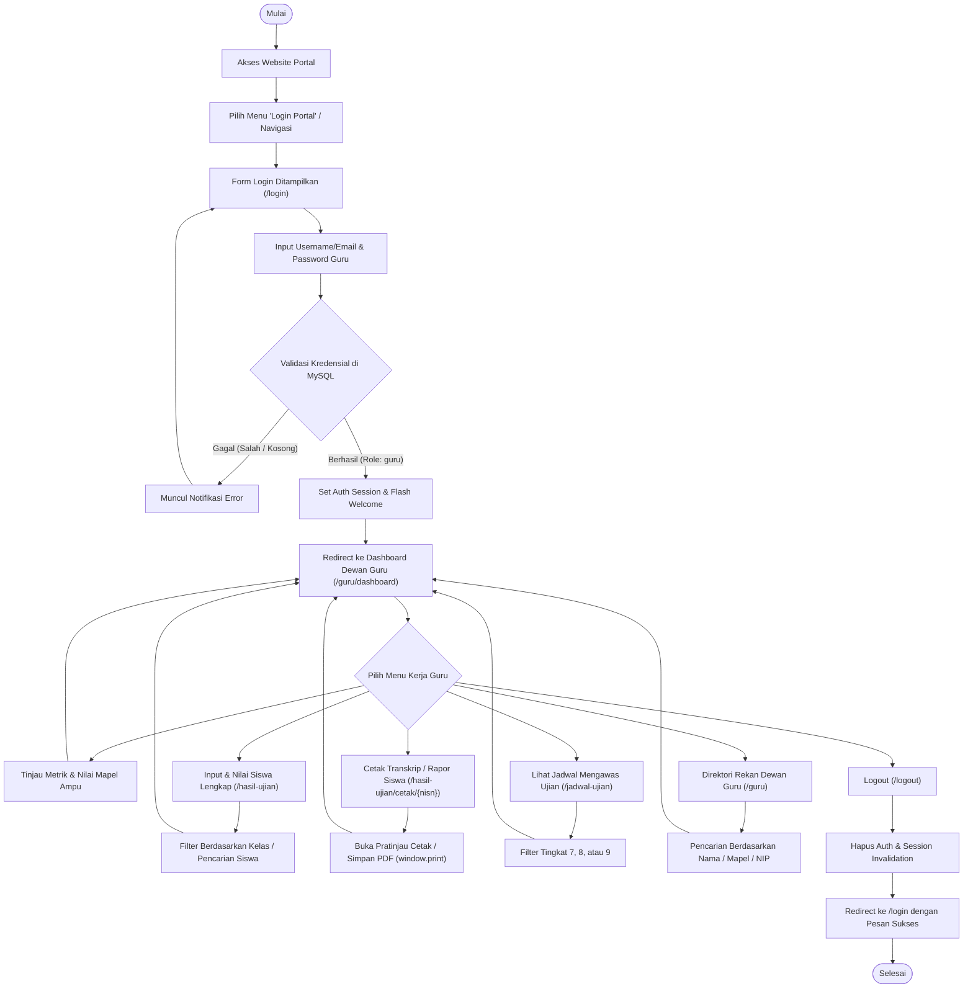
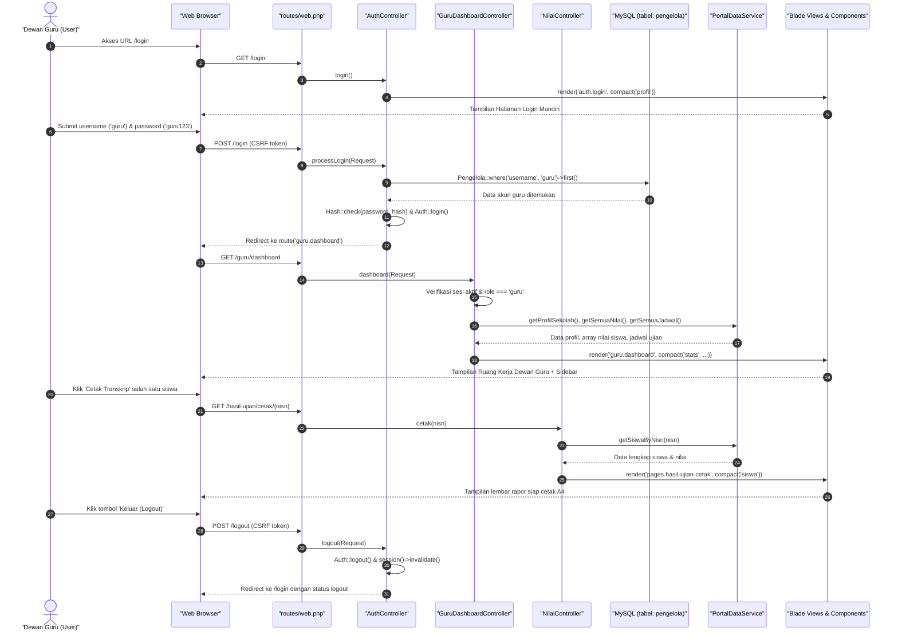

# Dokumentasi Alur Sistem: Role Guru / Dewan Guru
**PortalNilai-SMP3 — SMP Negeri 3 Unggulan**

Dokumentasi ini menyajikan panduan alur kerja (*user flow & system flow*) komprehensif khusus untuk **Role Guru / Dewan Guru** pada platform **PortalNilai-SMP3**. Seluruh penjelasan teknis (Route, Controller, Blade View, Service, dan Model) disusun secara faktual mengacu pada kode aktual aplikasi.

---

## 📑 Daftar Isi
1. [Ringkasan Peran Dewan Guru](#1-ringkasan-peran-dewan-guru)
2. [Diagram Alur Sistem (Mermaid Flowchart & Sequence)](#2-diagram-alur-sistem)
3. [Kredensial & Pengaturan Akun Dewan Guru](#3-kredensial--pengaturan-akun-dewan-guru)
4. [Penjelasan Tahapan Alur Berdasarkan Kode Aktual](#4-penjelasan-tahapan-alur-berdasarkan-kode-aktual)
   - [4.1 Alur Login & Autentikasi](#41-alur-login--autentikasi)
   - [4.2 Alur Dashboard (Ruang Kerja Dewan Guru)](#42-alur-dashboard-ruang-kerja-dewan-guru)
   - [4.3 Alur Input, Tinjauan, & Rekapitulasi Nilai Siswa](#43-alur-input-tinjauan--rekapitulasi-nilai-siswa)
   - [4.4 Alur Cetak Lembar Rapor / Transkrip Resmi](#44-alur-cetak-lembar-rapor--transkrip-resmi)
   - [4.5 Alur Jadwal Ujian & Tugas Pengawasan](#45-alur-jadwal-ujian--tugas-pengawasan)
   - [4.6 Alur Direktori Rekan Dewan Guru](#46-alur-direktori-rekan-dewan-guru)
   - [4.7 Alur Logout (Keluar Sistem)](#47-alur-logout-keluar-sistem)
5. [Matriks Rute, Controller, & Blade View Role Guru](#5-matriks-rute-controller--blade-view-role-guru)
6. [Kesesuaian dengan Dokumen PRD & Rencana Pengembangan](#6-kesesuaian-dengan-dokumen-prd--rencana-pengembangan)

---

## 1. Ringkasan Peran Dewan Guru

Berdasarkan [PRD.md](file:///C:/laragon/www/PortalNilai-SMP3/PRD.md) dan [PANDUAN_STRUKTUR_PORTALNILAI.md](file:///C:/laragon/www/PortalNilai-SMP3/PANDUAN_STRUKTUR_PORTALNILAI.md), peran **Guru / Dewan Guru** memiliki hak akses dan ruang lingkup kerja utama sebagai berikut:

- **Autentikasi Mandiri**: Masuk menggunakan kredensial terdaftar (Email/Username dan Kata Sandi) yang tersimpan pada tabel `pengelola` database MySQL.
- **Ruang Kerja Terpadu (Teacher Dashboard)**: Mengakses metrik ringkas mata pelajaran yang diampu, jumlah siswa bimbingan, rata-rata capaian belajar, NIP resmi, serta agenda pengawasan ujian terdekat.
- **Pengelolaan Nilai Belajar Siswa**: Memeriksa capaian nilai tugas, UTS, UAS, nilai akhir, predikat kelulusan (A/B/C), status KKM (75.0), serta memvalidasi leger nilai.
- **Pencetakan Dokumen Resmi**: Meninjau dan mencetak lembar rapor transkrip nilai resmi bertanda tangan wali kelas dan kepala sekolah.
- **Monitoring Jadwal & Pengawasan**: Mengetahui jadwal pelaksanaan ujian semester (PAS, CBT, Try Out), pembagian ruang ujian, dan jadwal mengawas kolaboratif.

---

## 2. Diagram Alur Sistem

### 2.1 Diagram Alur Kerja Pengguna (User Flowchart)



---

### 2.2 Diagram Urutan Interaksi Sistem (Sequence Diagram)



---

## 3. Kredensial & Pengaturan Akun Dewan Guru

Untuk pengujian dan operasional, akun Dewan Guru dikelola secara terpusat pada tabel `pengelola` di database MySQL `portalnilai`. Inisialisasi otomatis dilakukan oleh [`DatabaseInitService::ensureDatabaseReady()`](file:///C:/laragon/www/PortalNilai-SMP3/app/Services/DatabaseInitService.php#L80-L119).

| Properti Akun | Data Aktual | Keterangan |
| :--- | :--- | :--- |
| **Model Eloquent** | [`App\Models\Pengelola`](file:///C:/laragon/www/PortalNilai-SMP3/app/Models/Pengelola.php) | Terhubung ke tabel `pengelola` (dan view alias `pegelola`) |
| **Username** | `guru` | Identifier login alternatif |
| **Email Resmi** | `guru@smpn3.sch.id` | Identifier login utama |
| **Kata Sandi** | `guru123` | Di-hash menggunakan bcrypt (`Hash::make`) |
| **Role** | `guru` | Menentukan otorisasi akses ke ruang kerja guru |
| **Nama Lengkap** | **Hendro Prasetyo, M.Pd.** | Nama dewan guru aktif |
| **NIP** | `19800820 200501 1 008` | Nomor Induk Pegawai resmi |
| **Mata Pelajaran** | `Matematika` | Mata pelajaran yang diampu |
| **Jabatan** | Wakil Kepala Sekolah / Guru Matematika | Tugas struktural & fungsional |
| **Avatar / Foto** | `assets/img/users/guru.svg` | Foto profil yang tampil di sidebar & navbar |
| **No. Telepon / WA** | `0812-3456-7890` | Kontak darurat dinas |

---

## 4. Penjelasan Tahapan Alur Berdasarkan Kode Aktual

### 4.1 Alur Login & Autentikasi

#### A. Akses Halaman Form Login
- **Route**: `GET /login` | Named Route: `login` ([routes/web.php](file:///C:/laragon/www/PortalNilai-SMP3/routes/web.php#L29))
- **Controller**: [`AuthController@login`](file:///C:/laragon/www/PortalNilai-SMP3/app/Http/Controllers/AuthController.php#L24-L42)
- **Logika Eksekusi**:
  1. Menjalankan `DatabaseInitService::ensureDatabaseReady()` untuk memastikan database `portalnilai` dan tabel `pengelola` sudah siap beserta dummy akun guru.
  2. Mengecek apakah guru sudah memiliki sesi aktif:
     ```php
     if (Auth::check() || $request->session()->has('user')) {
         $user = Auth::user() ?? (object) session('user');
         if (($user->role ?? '') === 'guru') {
             return redirect()->route('guru.dashboard')->with('info', 'Anda sudah login sebagai Dewan Guru.');
         }
     }
     ```
  3. Mengambil profil institusi melalui `PortalDataService::getProfilSekolah()`.
  4. Me-render view autentikasi khusus.
- **Blade View**: [`resources/views/auth/login.blade.php`](file:///C:/laragon/www/PortalNilai-SMP3/resources/views/auth/login.blade.php)
  - Komponen Disertakan: [`components/notification.blade.php`](file:///C:/laragon/www/PortalNilai-SMP3/resources/views/components/notification.blade.php) untuk flash alert.
  - Karakteristik Tampilan: Desain mandiri *split-card* tanpa navbar dan footer publik.
  - Fitur Antarmuka:
    - Input Username / Email dengan autofocus.
    - Input Kata Sandi dengan tombol intip sandi (`toggle-password` pada [main.js](file:///C:/laragon/www/PortalNilai-SMP3/public/assets/js/main.js#L7-L22)).
    - Checkbox *Remember Me* untuk menyimpan token login (`remember_token`).
    - Tombol "Kembali ke Beranda" untuk kembali ke portal umum.
    - Bantuan kontak IT Helpdesk sekolah: `(021) 7890-1234` / `it.support@smpn3.sch.id`.

#### B. Pengiriman & Validasi Form Login
- **Route**: `POST /login` | Named Route: `login.process` ([routes/web.php](file:///C:/laragon/www/PortalNilai-SMP3/routes/web.php#L30))
- **Controller**: [`AuthController@processLogin`](file:///C:/laragon/www/PortalNilai-SMP3/app/Http/Controllers/AuthController.php#L47-L83)
- **Logika Eksekusi**:
  1. Sanitasi input: Mengambil `$identifier` dan `$password` dengan fungsi `trim()`.
  2. Validasi kelengkapan: Jika salah satu kosong, dikembalikan dengan flash error dan `withInput()`.
  3. Kueri data akun:
     ```php
     $pengelola = Pengelola::where('email', $identifier)
         ->orWhere('username', $identifier)
         ->first();
     ```
  4. Verifikasi sandi melalui `Hash::check($password, $pengelola->password)`.
  5. Penyimpanan sesi:
     ```php
     Auth::login($pengelola, $remember);
     session(['user' => $pengelola->toArray()]);
     ```
  6. Pengalihan role guru:
     ```php
     if ($pengelola->role === 'guru') {
         return redirect()->route('guru.dashboard')
             ->with('success', 'Selamat datang, ' . $pengelola->name . '! Anda masuk ke Ruang Kerja Dewan Guru.');
     }
     ```
  7. Jika kredensial salah: Dikembalikan ke form login dengan pesan kesalahan spesifik.

---

### 4.2 Alur Dashboard (Ruang Kerja Dewan Guru)

- **Route**: `GET /guru/dashboard` | Named Route: `guru.dashboard` ([routes/web.php](file:///C:/laragon/www/PortalNilai-SMP3/routes/web.php#L37))
- **Controller**: [`GuruDashboardController@dashboard`](file:///C:/laragon/www/PortalNilai-SMP3/app/Http/Controllers/GuruDashboardController.php#L20-L44)
- **Proteksi Akses (Otorisasi Role)**:
  ```php
  $activeUser = Auth::user() ?? (object) session('user');
  if (!$activeUser || ($activeUser->role ?? '') !== 'guru') {
      return redirect()->route('login')->with('error', 'Akses ditolak. Halaman ini khusus Dewan Guru.');
  }
  ```
  > Bila admin atau pengunjung tanpa login mencoba membuka rute ini, sistem secara preventif mengalihkan kembali ke `/login`.

- **Penyusunan Data & Statistik**:
  Controller mengompilasi statistik dinamis dari [`PortalDataService`](file:///C:/laragon/www/PortalNilai-SMP3/app/Services/PortalDataService.php):
  - `total_siswa_ampu`: Jumlah seluruh siswa diampu (dihitung dari `count($semuaNilai)`).
  - `total_kelas`: 4 rombel (Kelas 7-A, 8-B, 9-A, 9-C).
  - `mapel`: Diambil dari atribut akun guru (`$activeUser->mapel ?? 'Matematika'`).
  - `nip`: Nomor induk resmi pendidik.
  - `rata_rata_mapel`: Rata-rata capaian nilai belajar siswa pada mata pelajaran diampu.

- **Blade View**: [`resources/views/guru/dashboard.blade.php`](file:///C:/laragon/www/PortalNilai-SMP3/resources/views/guru/dashboard.blade.php)
  - Layout Wrapper: `main-wrapper` dengan layout fleksibel dua kolom (*sidebar + content-area*).
  - Komponen Sub-view:
    1. [`komponen_guru/sidebar_guru.blade.php`](file:///C:/laragon/www/PortalNilai-SMP3/resources/views/komponen_guru/sidebar_guru.blade.php): Bilah navigasi samping bernuansa hijau *emerald-navy*, menampilkan identitas guru aktif (foto, nama, mapel, NIP), menu kerja, tautan publik, dan tombol logout.
    2. [`components/notification.blade.php`](file:///C:/laragon/www/PortalNilai-SMP3/resources/views/components/notification.blade.php): Menampilkan flash alert sambutan login.
  - Bagian Tampilan Utama:
    - **Header Topbar**: Menampilkan salam personal kepada guru, informasi semester aktif, serta tombol pintas "Beranda Publik".
    - **4 Kartu Metrik (Stat Cards)**:
      1. *Siswa Diampu*: Total siswa aktif di berbagai jenjang kelas.
      2. *Mata Pelajaran*: Nama bidang studi yang diampu (Kurikulum Merdeka).
      3. *Rata-rata Nilai*: Rata-rata capaian belajar dengan indikator kelulusan di atas KKM (75.0).
      4. *Status Akun Guru*: Status verifikasi resmi dan nomor NIP.
    - **Tabel Rekapitulasi Nilai Siswa Mata Pelajaran**:
      - Kolom: No, NISN / Nama Siswa, Kelas, Nilai Mapel, Predikat Belajar, Keterangan Tuntas KKM, dan Aksi Cetak.
      - Penghitungan predikat otomatis: Nilai $\ge 90$ predikat **A (Sangat Baik)**, $\ge 80$ predikat **B (Baik)**, lainnya **C (Cukup)**.
      - Tombol aksi cepat: "Input Nilai Baru" dan "Cetak Leger" (menghubungkan ke modul nilai).
    - **Widget Jadwal Mengawas Ujian Guru**:
      - Menampilkan 4 agenda pengawasan terdekat yang memuat: Hari/Tanggal, Sesi/Waktu ujian, Mata pelajaran yang diawasi, Ruangan, dan Badge status "Bertugas".

---

### 4.3 Alur Input, Tinjauan, & Rekapitulasi Nilai Siswa

Dewan Guru memiliki modul terpadu untuk mengelola nilai siswa:

#### A. Halaman Tabel Data Nilai Siswa
- **Route**: `GET /guru/nilai` | Named Route: `guru.nilai` ([routes/web.php](file:///C:/laragon/www/PortalNilai-SMP3/routes/web.php#L38))
- **Controller**: [`GuruDashboardController@dataNilai`](file:///C:/laragon/www/PortalNilai-SMP3/app/Http/Controllers/GuruDashboardController.php)
- **Blade View**: [`resources/views/guru/datanilai.blade.php`](file:///C:/laragon/www/PortalNilai-SMP3/resources/views/guru/datanilai.blade.php)
  - Layout: `main-wrapper` dengan [`komponen_guru/sidebar_guru.blade.php`](file:///C:/laragon/www/PortalNilai-SMP3/resources/views/komponen_guru/sidebar_guru.blade.php).
  - Fitur Antarmuka Utama:
    - **4 Kartu Metrik Ringkasan**: Total Siswa Dinilai, Rata-rata Kelas, Siswa Tuntas KKM (&ge; 75), dan Siswa Perlu Remedial (&lt; 75).
    - **Toolbar Pencarian & Filter Kelas**: Pencarian nama/NISN siswa, filter rombel (7-A, 8-B, 9-A, 9-C), dan filter status kelulusan (Tuntas/Remedial).
    - **Tabel Nilai Komprehensif**: Menampilkan No, Identitas Siswa (Avatar & NISN/NIS), Kelas, Nilai Tugas (30%), UTS (30%), UAS (40%), Nilai Akhir otomatis, Predikat Capaian (A/B/C/D), Status KKM (Tuntas/Remedial), dan Tombol Aksi.
    - **Tombol Tambah Nilai Baru**: Membuka halaman form tersendiri ([`inputnilai.blade.php`](file:///C:/laragon/www/PortalNilai-SMP3/resources/views/guru/inputnilai.blade.php)) tanpa popup/modal.
    - **Aksi Tiap Baris**:
      - Tombol **Edit**: Membuka form edit nilai khusus untuk siswa bersangkutan (`/guru/nilai/edit/{nisn}`).
      - Tombol **Hapus**: Menghapus data nilai siswa dengan konfirmasi keamanan (`POST /guru/nilai/hapus/{nisn}`).
      - Tombol **Cetak**: Membuka lembar transkrip resmi siap cetak A4.

#### B. Halaman Form Khusus Input, Edit, & Hapus Nilai Siswa (Tanpa Popup)
- **Route Input Baru**: `GET /guru/nilai/input` | Named Route: `guru.nilai.input` ([routes/web.php](file:///C:/laragon/www/PortalNilai-SMP3/routes/web.php#L39))
- **Route Edit**: `GET /guru/nilai/edit/{nisn}` | Named Route: `guru.nilai.edit` ([routes/web.php](file:///C:/laragon/www/PortalNilai-SMP3/routes/web.php#L40))
- **Route Simpan**: `POST /guru/nilai/simpan` | Named Route: `guru.nilai.simpan` ([routes/web.php](file:///C:/laragon/www/PortalNilai-SMP3/routes/web.php#L41))
- **Route Hapus**: `POST /guru/nilai/hapus/{nisn}` | Named Route: `guru.nilai.hapus` ([routes/web.php](file:///C:/laragon/www/PortalNilai-SMP3/routes/web.php#L42))
- **Controller**: [`GuruDashboardController@formNilai`](file:///C:/laragon/www/PortalNilai-SMP3/app/Http/Controllers/GuruDashboardController.php), [`GuruDashboardController@simpanNilai`](file:///C:/laragon/www/PortalNilai-SMP3/app/Http/Controllers/GuruDashboardController.php), & [`GuruDashboardController@hapusNilai`](file:///C:/laragon/www/PortalNilai-SMP3/app/Http/Controllers/GuruDashboardController.php)
- **Blade View**: [`resources/views/guru/inputnilai.blade.php`](file:///C:/laragon/www/PortalNilai-SMP3/resources/views/guru/inputnilai.blade.php)
  - Formulir mandiri penuh (*full-page form*) tanpa popup modal.
  - **Mode Tambah Siswa Baru**: Menyediakan pemilihan cepat siswa terdaftar dari basis data atau pengisian identitas siswa baru secara manual.
  - **Mode Edit**: Menampilkan identitas peserta didik terpilih dan nilai sebelumnya secara otomatis (*pre-filled*).
  - **Live Auto-Calculator**: Perhitungan otomatis nilai akhir ($30\% \times \text{Tugas} + 30\% \times \text{UTS} + 40\% \times \text{UAS}$), pembaruan predikat (A/B/C/D), dan status KKM (Tuntas/Remedial) saat angka diketik.
  - **Catatan Pembelajaran**: Kolom masukan perkembangan belajar yang tercetak pada buku rapor.
  - **Aksi Hapus Nilai**: Tersedia tombol dan modal konfirmasi hapus nilai khusus pada mode edit.

#### C. Modul Hasil Ujian & Tinjauan Rapor Siswa (Publik / Evaluasi)
- **Route**: `GET /hasil-ujian` | Named Route: `nilai` ([routes/web.php](file:///C:/laragon/www/PortalNilai-SMP3/routes/web.php#L23))
- **Controller**: [`NilaiController@index`](file:///C:/laragon/www/PortalNilai-SMP3/app/Http/Controllers/NilaiController.php#L17-L36)
- **Blade View**: [`resources/views/pages/hasil-ujian.blade.php`](file:///C:/laragon/www/PortalNilai-SMP3/resources/views/pages/hasil-ujian.blade.php)
  - Master Layout: [`resources/views/layouts/app.blade.php`](file:///C:/laragon/www/PortalNilai-SMP3/resources/views/layouts/app.blade.php).
  - Tinjauan seluruh mata pelajaran siswa dengan metrik ranking kelas dan status remedial.

---

### 4.4 Alur Cetak Lembar Rapor / Transkrip Resmi

- **Route**: `GET /hasil-ujian/cetak/{nisn}` | Named Route: `nilai.cetak` ([routes/web.php](file:///C:/laragon/www/PortalNilai-SMP3/routes/web.php#L24))
- **Controller**: [`NilaiController@cetak`](file:///C:/laragon/www/PortalNilai-SMP3/app/Http/Controllers/NilaiController.php#L38-L48)
- **Logika Eksekusi**:
  1. Mencari data siswa tunggal berdasarkan parameter `$nisn` menggunakan `$this->portalData->getSiswaByNisn($nisn)`.
  2. Jika data tidak ditemukan, sistem me-redirect kembali ke halaman `/hasil-ujian` dengan pesan flash error.
  3. Jika ditemukan, data di-passing ke view lembar cetak resmi.
- **Blade View**: [`resources/views/pages/hasil-ujian-cetak.blade.php`](file:///C:/laragon/www/PortalNilai-SMP3/resources/views/pages/hasil-ujian-cetak.blade.php)
  - Karakteristik Dokumen:
    - Menggunakan standar tipografi akademik (*Times New Roman*) dengan format lembar dokumen resmi (*page-sheet*).
    - **Kop Surat Resmi Kedinasan**: Logo SMPN 3, nama dinas pendidikan, nama sekolah, alamat, telepon, dan website resmi.
    - **Identitas Lengkap Siswa**: Nama, NISN/NIS, Kelas, Semester, dan Wali Kelas pengampu.
    - **Tabel Nilai Transkrip**: Seluruh mata pelajaran, KKM standar, nilai angka, nilai predikat, dan capaian kompetensi.
    - **Metrik Rekapitulasi**: Total nilai, nilai rata-rata akhir, peringkat kelas, dan keputusan hasil belajar.
    - **Area Tanda Tangan Resmi Tiga Pihak**:
      1. Tanda tangan Orang Tua / Wali Siswa.
      2. Tanda tangan Guru Wali Kelas (disertai gelar dan NIP).
      3. Pengesahan Kepala Sekolah: **Drs. H. Bambang Sudarmono, M.Pd.** (NIP: `19680512 199303 1 004`).
    - **Bilah Aksi Cetak Mengambang (*Floating Bar*)**: Dilengkapi tombol "Cetak / Simpan PDF" yang mengeksekusi `window.print()`, dengan styling CSS `@media print` yang otomatis menyembunyikan bilah tombol navigasi saat pencetakan fisik atau penyimpanan PDF berlangsung.

---

### 4.5 Alur Jadwal Ujian & Tugas Pengawasan

Dewan Guru dapat memantau jadwal pelaksanaan ujian dan pembagian tugas pengawasan melalui dua titik:

#### A. Widget Jadwal Mengawas di Dashboard Guru
- Diakses pada rute `guru.dashboard`, menampilkan 4 sesi terdekat mata pelajaran ujian dengan penugasan ruang dan waktu bagi guru yang bertugas.

#### B. Halaman Jadwal Ujian Lengkap
- **Route**: `GET /jadwal-ujian` | Named Route: `jadwal` ([routes/web.php](file:///C:/laragon/www/PortalNilai-SMP3/routes/web.php#L25))
- **Controller**: [`JadwalController@index`](file:///C:/laragon/www/PortalNilai-SMP3/app/Http/Controllers/JadwalController.php#L17-L24)
- **Logika Eksekusi**:
  1. Membaca query filter `$tingkat` (nilai default: `'Semua'`).
  2. Mengambil data jadwal terfilter dari `$this->portalData->getJadwalUjian($tingkat)`.
- **Blade View**: [`resources/views/pages/jadwal-ujian.blade.php`](file:///C:/laragon/www/PortalNilai-SMP3/resources/views/pages/jadwal-ujian.blade.php)
  - Master Layout: [`layouts/app.blade.php`](file:///C:/laragon/www/PortalNilai-SMP3/resources/views/layouts/app.blade.php).
  - Fitur yang Digunakan Guru:
    - **Tab Filter Tingkat**: Memilih semua tingkat atau tingkat khusus (Kelas 7, Kelas 8, atau Kelas 9).
    - **Tabel Pelaksanaan Ujian**: Menampilkan Hari & Tanggal, Waktu/Sesi (WIB), Tingkat Kelas sasaran, Mata Pelajaran & Jenis Ujian (PAS, Ujian Berbasis Komputer / CBT di Lab, Try Out US), Ruangan pelaksanaan (Ruang 01 s/d Ruang 12, Lab Komputer 1 & 2), Pengawas Ujian (kolaborasi sesama dewan guru), dan Status pelaksanaan.
    - **Pemberitahuan Tata Tertib**: Tata tertib resmi pelaksanaan ujian semester bagi pengawas dan siswa.
    - **Tombol Cetak Jadwal**: Tombol cetak langsung agenda jadwal ujian sekolah.

---

### 4.6 Alur Direktori Rekan Dewan Guru

Untuk koordinasi antar-pengajar mata pelajaran dan wali kelas, tersedia direktori dewan guru:

- **Route**: `GET /guru` | Named Route: `guru` ([routes/web.php](file:///C:/laragon/www/PortalNilai-SMP3/routes/web.php#L26))
- **Controller**: [`GuruController@index`](file:///C:/laragon/www/PortalNilai-SMP3/app/Http/Controllers/GuruController.php#L17-L30)
- **Blade View**: [`resources/views/pages/guru.blade.php`](file:///C:/laragon/www/PortalNilai-SMP3/resources/views/pages/guru.blade.php)
  - Master Layout: [`layouts/app.blade.php`](file:///C:/laragon/www/PortalNilai-SMP3/resources/views/layouts/app.blade.php).
  - Fitur:
    - Pencarian guru berdasarkan nama, mata pelajaran, atau NIP.
    - Filter kategori mata pelajaran (Matematika, IPA, Bahasa Indonesia, Bahasa Inggris, Informatika, PPKn, PJOK, BK, dll.).
    - Kartu profil guru: NIP, Jabatan struktural, Latar belakang pendidikan tinggi, Pengalaman mengajar, dan Tombol kontak surel (*email link*).

---

### 4.7 Alur Logout (Keluar Sistem)

- **Route**: `POST /logout` | Named Route: `logout` ([routes/web.php](file:///C:/laragon/www/PortalNilai-SMP3/routes/web.php#L31))
- **Controller**: [`AuthController@logout`](file:///C:/laragon/www/PortalNilai-SMP3/app/Http/Controllers/AuthController.php#L87-L94)
- **Titik Pemicu (*Trigger*)**:
  1. Tombol merah **"Keluar (Logout)"** di bagian bawah [sidebar_guru.blade.php](file:///C:/laragon/www/PortalNilai-SMP3/resources/views/komponen_guru/sidebar_guru.blade.php#L82-L89).
  2. Pilihan dropdown akun guru pada [navbar.blade.php](file:///C:/laragon/www/PortalNilai-SMP3/resources/views/komponen_website/navbar.blade.php#L140-L146).
- **Logika Eksekusi Controller**:
  ```php
  public function logout(Request $request)
  {
      Auth::logout();
      $request->session()->invalidate();
      $request->session()->regenerateToken();

      return redirect()->route('login')
          ->with('info', 'Anda telah berhasil keluar (logout) dari sistem portal.');
  }
  ```
- **Hasil Akhir**:
  - Sesi otentikasi dihapus dari penyimpanan sesi aplikasi.
  - Token sesi CSRF diperbarui untuk mencegah *session fixation*.
  - Guru diarahkan kembali ke rute `login` (`/login`) disertai flash notification warna biru (`info`) yang mengonfirmasi bahwa sesi telah berakhir dengan aman.

---

## 5. Matriks Rute, Controller, & Blade View Role Guru

Berikut adalah rangkuman seluruh pemetaan teknis yang digunakan pada alur kerja Role Guru / Dewan Guru di PortalNilai-SMP3:

| Tahapan Alur | HTTP Method | URL Route | Named Route | Controller & Method | Blade View Utama | Layout / Sub-Komponen |
| :--- | :---: | :--- | :--- | :--- | :--- | :--- |
| **Halaman Login** | `GET` | `/login` | `login` | `AuthController@login` | [`auth/login.blade.php`](file:///C:/laragon/www/PortalNilai-SMP3/resources/views/auth/login.blade.php) | [`components/notification.blade.php`](file:///C:/laragon/www/PortalNilai-SMP3/resources/views/components/notification.blade.php) |
| **Proses Login** | `POST` | `/login` | `login.process` | `AuthController@processLogin` | *(Redirect ke `guru.dashboard`)* | *(Validasi Form & CSRF)* |
| **Dashboard Guru** | `GET` | `/guru/dashboard` | `guru.dashboard` | `GuruDashboardController@dashboard` | [`guru/dashboard.blade.php`](file:///C:/laragon/www/PortalNilai-SMP3/resources/views/guru/dashboard.blade.php) | [`komponen_guru/sidebar_guru.blade.php`](file:///C:/laragon/www/PortalNilai-SMP3/resources/views/komponen_guru/sidebar_guru.blade.php)<br>[`components/notification.blade.php`](file:///C:/laragon/www/PortalNilai-SMP3/resources/views/components/notification.blade.php) |
| **Tabel Nilai Siswa (Dewan Guru)** | `GET` | `/guru/nilai` | `guru.nilai` | `GuruDashboardController@dataNilai` | [`guru/datanilai.blade.php`](file:///C:/laragon/www/PortalNilai-SMP3/resources/views/guru/datanilai.blade.php) | [`komponen_guru/sidebar_guru.blade.php`](file:///C:/laragon/www/PortalNilai-SMP3/resources/views/komponen_guru/sidebar_guru.blade.php) |
| **Form Input Nilai Baru (Tanpa Popup)** | `GET` | `/guru/nilai/input` | `guru.nilai.input` | `GuruDashboardController@formNilai` | [`guru/inputnilai.blade.php`](file:///C:/laragon/www/PortalNilai-SMP3/resources/views/guru/inputnilai.blade.php) | Mode `create`, live auto-calculator |
| **Form Edit Nilai Siswa (Tanpa Popup)** | `GET` | `/guru/nilai/edit/{nisn}` | `guru.nilai.edit` | `GuruDashboardController@formNilai` | [`guru/inputnilai.blade.php`](file:///C:/laragon/www/PortalNilai-SMP3/resources/views/guru/inputnilai.blade.php) | Mode `edit`, prefilled data & tombol hapus |
| **Simpan / Update Nilai Siswa** | `POST` | `/guru/nilai/simpan` | `guru.nilai.simpan` | `GuruDashboardController@simpanNilai` | *(Redirect ke `guru.nilai`)* | *(Kalkulasi Bobot 30/30/40 & Simpan Sesi)* |
| **Hapus Nilai Siswa** | `POST` | `/guru/nilai/hapus/{nisn}` | `guru.nilai.hapus` | `GuruDashboardController@hapusNilai` | *(Redirect ke `guru.nilai`)* | *(Konfirmasi Keamanan & Eliminasi Sesi)* |
| **Hasil Ujian Siswa (Publik/Umum)** | `GET` | `/hasil-ujian` | `nilai` | `NilaiController@index` | [`pages/hasil-ujian.blade.php`](file:///C:/laragon/www/PortalNilai-SMP3/resources/views/pages/hasil-ujian.blade.php) | [`layouts/app.blade.php`](file:///C:/laragon/www/PortalNilai-SMP3/resources/views/layouts/app.blade.php)<br>[`komponen_website/navbar.blade.php`](file:///C:/laragon/www/PortalNilai-SMP3/resources/views/komponen_website/navbar.blade.php)<br>[`komponen_website/footer.blade.php`](file:///C:/laragon/www/PortalNilai-SMP3/resources/views/komponen_website/footer.blade.php) |
| **Cetak Transkrip / Rapor** | `GET` | `/hasil-ujian/cetak/{nisn}` | `nilai.cetak` | `NilaiController@cetak` | [`pages/hasil-ujian-cetak.blade.php`](file:///C:/laragon/www/PortalNilai-SMP3/resources/views/pages/hasil-ujian-cetak.blade.php) | Standar Cetak Mandiri (*Print Sheet CSS*) |
| **Jadwal Ujian & Pengawasan**| `GET` | `/jadwal-ujian` | `jadwal` | `JadwalController@index` | [`pages/jadwal-ujian.blade.php`](file:///C:/laragon/www/PortalNilai-SMP3/resources/views/pages/jadwal-ujian.blade.php) | [`layouts/app.blade.php`](file:///C:/laragon/www/PortalNilai-SMP3/resources/views/layouts/app.blade.php) |
| **Direktori Rekan Guru** | `GET` | `/guru` | `guru` | `GuruController@index` | [`pages/guru.blade.php`](file:///C:/laragon/www/PortalNilai-SMP3/resources/views/pages/guru.blade.php) | [`layouts/app.blade.php`](file:///C:/laragon/www/PortalNilai-SMP3/resources/views/layouts/app.blade.php) |
| **Proses Logout** | `POST` | `/logout` | `logout` | `AuthController@logout` | *(Redirect ke `login`)* | *(Hapus Session & Regenerasi Token)* |

---

## 6. Kesesuaian dengan Dokumen PRD & Rencana Pengembangan

Implementasi alur dewan guru pada kode saat ini telah memenuhi kebutuhan inti yang tertuang dalam [PRD.md](file:///C:/laragon/www/PortalNilai-SMP3/PRD.md):

1. **Autentikasi & Otorisasi Berbasis Role (PRD Bagian 4 & FR-01, FR-02)**:
   - Guru dan Administrator IT dipisahkan melalui field `role` di tabel `pengelola`. Guru memiliki rute dan tampilan ruang kerja terisolasi (`/guru/dashboard`).
2. **Dashboard Guru & Tinjauan Siswa Diampu (PRD Bagian 6.2 Alur Guru Langkah 1-2)**:
   - Dashboard menampilkan ringkasan jumlah siswa bimbingan, mata pelajaran yang diampu, nilai rata-rata, dan NIP resmi.
3. **Penyajian Nilai per Komponen & Validasi KKM (PRD FR-11 s/d FR-20)**:
   - Komponen nilai mencakup Tugas, UTS, UAS, Nilai Akhir, serta status kelulusan KKM 75.0 dengan pewarnaan badge otomatis.
4. **Cetak & Export Laporan Hasil Belajar (PRD FR-21)**:
   - Lembar hasil evaluasi resmi siap cetak / simpan format PDF via browser print stylesheet.
5. **Rencana Rilis Lanjutan (Fase 3 & 4 PRD)**:
   - Formulir modal input langsung perubahan nilai angka (Tugas, UH, UTS, UAS) yang menyimpan mutasi nilai secara real-time ke tabel relasional nilai siswa.
   - Fitur impor nilai massal melalui format template Excel (.xlsx / .csv).

---
*Dokumen ini dibuat otomatis sebagai panduan referensi alur kerja resmi Dewan Guru pada sistem PortalNilai-SMP3.*
